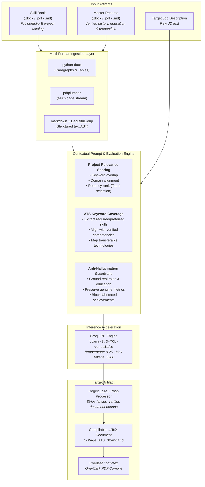

<div align="center">

# 📄 ATS Resume Compiler — Contextual AI LaTeX Tailoring Engine

**High-precision, ATS-optimized LaTeX resume generator powered by Groq LPU & Llama 3.3 70B.**  
*Dynamically scores multi-project candidate portfolios against job descriptions without hallucination.*

[](https://www.python.org/)
[](https://fastapi.tiangolo.com/)
[](https://groq.com/)
[](https://www.overleaf.com/)
[](LICENSE)

</div>

---

## 📌 Executive Summary

Most "AI resume generators" are basic ChatGPT wrappers that produce unstructured, verbose text and frequently hallucinate qualifications. **ATS Resume Compiler** takes a systems-engineering approach:

1. **Dual Source of Truth:** Separates immutable candidate ground truth (**Master Resume**) from the broader project portfolio (**Skill Bank**).
2. **Contextual Relevance Scoring:** Ingests the target **Job Description (JD)** and programmatically scores up to 10 candidate projects across technical overlap, domain alignment, and recency—selecting only the top 4 highest-signal projects.
3. **Deterministic ATS LaTeX Output:** Generates clean, production-grade LaTeX constrained by a strict geometry schema ensuring **guaranteed 1-page fit**, perfect typographic hierarchy, and seamless machine parsing by Applicant Tracking Systems.
4. **Ultra-Fast Generation:** Leveraging Groq's LPUs running `llama-3.3-70b-versatile` to synthesize tailored, compilable resumes with sub-second token latency.

---

## 🏗 Architecture & Data Flow



---

## ✨ Core Engineering Capabilities

### 1. Multi-Format Ingestion Pipeline
- **DOCX Extractor:** Recursively extracts paragraphs and structured table cells via `python-docx`.
- **PDF Extractor:** Streamlines text extraction across multi-page layouts using `pdfplumber`.
- **Markdown Extractor:** Decodes `.md` raw source and leverages `BeautifulSoup` to normalize headings, lists, and links into clean NLP text.

### 2. Intelligent Project Selection & Alignment
- Evaluates candidate portfolios containing up to 10 projects.
- Ranks candidate experience against the JD using semantic match density.
- Filters out non-relevant legacy projects to highlight the 2–4 most impactful domain matches.
- Reformulates bullet points to foreground JD-specific technologies while strictly respecting verified source metrics.

### 3. Anti-Hallucination Guardrails
- **Ground Truth Enforcement:** Candidate contact details, education, GPA, company names, and dates are pulled verbatim from the Master Resume.
- **Controlled Keyword Surfacing:** Surfaces adjacent competencies in the Technical Skills section based on actual candidate exposure without fabricating unverified project roles or accomplishments.

### 4. 1-Page Constraint & Clean LaTeX Geometry
- Engineered with custom `\resumeHeading` and `\projectHeading` commands using `tabularx` for alignment.
- Calibrated margin spacing (`0.40in` top/bottom, `0.60in` left/right) and compact list spacing to ensure every generated CV compiles into a clean, uncrowded single-page PDF.

---

## 🛠 Tech Stack

| Component | Technology | Role |
| :--- | :--- | :--- |
| **Backend Framework** | [FastAPI](https://fastapi.tiangolo.com/) | Async REST API & static asset delivery |
| **LLM Inference** | [Groq Cloud](https://groq.com/) | Sub-second inference via `llama-3.3-70b-versatile` |
| **Document Parsers** | `python-docx`, `pdfplumber`, `markdown`, `beautifulsoup4` | Multi-format document ingestion |
| **Server & Runtime** | `uvicorn`, Python 3.11+ | High-concurrency ASGI web server |
| **Frontend UI** | Vanilla HTML5 / CSS3 / JavaScript | Modern, dark-mode responsive client interface |
| **Document Compiler** | LaTeX / [Overleaf](https://overleaf.com) | Typesetting engine for publication-quality PDFs |

---

## 🚀 Getting Started

### Prerequisites
- Python 3.11 or higher
- A free [Groq API Key](https://console.groq.com/)

### 1. Clone & Set Up Virtual Environment

```bash
git clone https://github.com/mafaqbhatti/ats-resume-compiler.git
cd ats-resume-compiler

# Create and activate virtual environment
python -m venv .venv
# On Windows:
.venv\Scripts\activate
# On Linux/macOS:
source .venv/bin/activate
```

### 2. Install Dependencies

```bash
pip install -r requirements.txt
```

### 3. Configure Environment

Copy the example environment file and configure your API key:

```bash
cp .env.example .env
```

Edit `.env`:
```ini
GROQ_API_KEY=gsk_your_groq_api_key_here
```

*(Note: You can also leave this blank and provide your Groq API key directly via the Web UI)*.

### 4. Run the Application

```bash
python main.py
```
Or start directly with `uvicorn`:
```bash
uvicorn main:app --host 0.0.0.0 --port 8000 --reload
```

Navigate to **`http://localhost:8000`** in your browser.

---

## 💻 Usage Workflow

1. **Upload Skill Bank:** Upload your comprehensive multi-project portfolio (`.docx`, `.pdf`, or `.md`).
2. **Upload Master Resume:** Upload your baseline resume containing verified contact details, employment history, and education.
3. **Paste Job Description:** Copy and paste the full job posting text.
4. **Compile:** Click **Generate Resume** (generation typically finishes in under 5 seconds).
5. **Typeset:** Copy the raw output into [Overleaf](https://overleaf.com) or compile locally with `pdflatex resume.tex`.

---

## 🔌 API Reference

### Health Check
```http
GET /health
```
**Response:**
```json
{
  "status": "ok",
  "model": "llama-3.3-70b-versatile",
  "env_key_set": true
}
```

### Generate Resume
```http
POST /generate-resume
```
**Content-Type:** `multipart/form-data`

| Parameter | Type | Required | Description |
| :--- | :--- | :--- | :--- |
| `skill_bank` | File | Yes | Candidate skill bank (`.docx`, `.pdf`, `.md`) |
| `master_resume` | File | Yes | Candidate master resume (`.docx`, `.pdf`, `.md`) |
| `job_description` | String | Yes | Plain text of target job posting |
| `groq_api_key` | String | No | Optional API key override (if not set in `.env`) |

**cURL Example:**
```bash
curl -X POST "http://localhost:8000/generate-resume" \
  -F "skill_bank=@portfolio.docx" \
  -F "master_resume=@master_resume.pdf" \
  -F "job_description=Senior MLOps Engineer needed with Kubernetes, MLflow, Docker experience..."
```

**Response Format:**
```json
{
  "success": true,
  "latex_code": "\\documentclass[9.5pt, letterpaper]{article}...",
  "stats": {
    "skill_bank_chars": 3410,
    "resume_chars": 2890,
    "latex_chars": 4720
  }
}
```

---

## 📂 Project Structure

```
ats-resume-compiler/
├── main.py              # FastAPI service, document parsers & prompt pipeline
├── frontend.html        # Interactive dark-mode client interface
├── requirements.txt     # Production dependencies
├── .env.example         # Template for environment configuration
├── .gitignore           # Git ignore rules for virtualenvs and secrets
└── README.md            # System architecture and documentation
```

---

## 📄 License
This project is licensed under the MIT License — see the [LICENSE](LICENSE) file for details.
